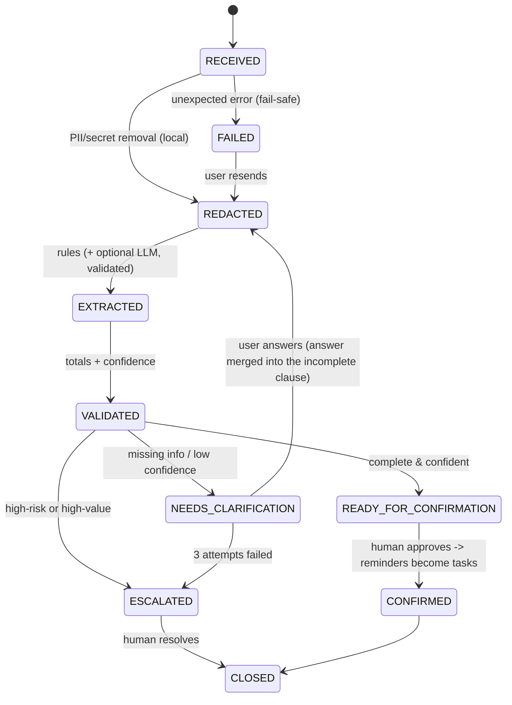

# Bol2Kaam (बोल → काम) — Voice-to-Structured-Action Worker

> An offline-first AI Worker that turns a micro-entrepreneur's spoken (or typed) Hinglish/English
> daily note into **structured business records, reminders, exceptions and escalations** —
> with PII redacted **on the device before anything else happens**, a human approving every action,
> and a tamper-evident audit trail.

Built for the Eko *AI Systems / Agentic Workflow* assignment — direction chosen:
**Voice-to-Structured-Action Worker** (with a built-in evaluation harness and a device-constrained design).

* Pure Python 3.8+ **standard library only** — no pip install, runs on a low-end laptop/desktop (Termux on Android works too).
* Default engine is deterministic rules: ~1 ms/note, ₹0 per run, fully offline.
* Optional local LLM (Ollama) is **untrusted**: its output is schema-checked, grounded against the input and cross-checked against the rules; on any failure the worker falls back to rules.

```bash
python3 demo.py                              # scripted 9-scene demo (the video)
python3 eval/run_eval.py                     # 24-case evaluation harness
python3 -m unittest discover -s tests        # 15 unit tests
python3 cli.py --today 2026-10-10 ingest --file samples/note1_happy.txt
```

---
## 1. Definition (as requested before building)

| | |
|---|---|
| **Goal** | Make a shopkeeper's daily record-keeping take ~one voice note instead of a notebook: capture sales, expenses, credit (udhaar), dues, follow-ups and problems — so cash-flow is visible, follow-ups don't get forgotten, and risky events reach a human fast. |
| **User** | A micro-entrepreneur / retailer / agent (low digital comfort, Hinglish, small phone screen). Secondary: the field supervisor who receives escalations. |
| **System** | Sits inside Eko's field workflow: *entrepreneur note → Worker → human confirmation → local ledger & reminders → (consented, aggregated) signal to Eko / escalation to supervisor*. |
| **Inputs** | Voice note (optional offline whisper.cpp) or text/transcript. Tools: local rules engine, optional local LLM, local JSON store. No internet needed. |
| **Outputs** | JSON record: `sales, expenses, credits (receivable/payable/settled), reminders (with resolved dates), exceptions (severity), escalations, clarification questions, confidence, totals`. |
| **Decisions** | May: classify, resolve relative dates ("kal", "parso", "Monday"), compute totals, ask a clarifying question, propose reminders, recommend escalation. |
| **Constraints** | Must NOT: guess missing amounts, give financial/legal advice, move money, message customers, schedule anything before human confirmation, collect unnecessary personal data, or send anything to Eko without consent. |
| **Device constraint** | Low-end phone/laptop, no GPU, flaky/no internet, small screen, local language. Design: stdlib only, ~1 ms CPU, text-first UI (CLI today; a WhatsApp-style/Android front-end is the next step), all state in small JSON files. |
| **Definition of Done** | A note is *done* when: (1) PII removed; (2) every extracted amount is grounded in the input; (3) no unanswered missing-info question; (4) confidence ≥ 0.6 **or** escalated to a human; (5) a human confirmed (or a human resolved the escalation); (6) every state change is in the audit log. |
| **Escalation** | Stop and ask a human on: OTP/PIN shared, money deducted, fraud/scam, theft/threat/police, amount ≥ ₹50,000, or 3 failed clarification attempts. MEDIUM issues (complaint, refund, failed txn) → *inform* supervisor without blocking. |
| **Success metric** | See §9 (time-to-log, correction rate, follow-up completion, escalation precision/recall, PII leak rate = 0). |

---
## 2. Workflow states & transitions


Illegal transitions raise `InvalidTransition` (e.g. confirming a note that still needs clarification) — see `tests/`.

## 3. Sample input → output

Input (dummy): `Aaj subah 10 packet chai becha 450 me, 5 packet namkeen becha 250 me. Kiraya 3000 diya. Anil ko 600 ka udhaar diya, parso wapas lena hai. Ek customer ka UPI payment atak gaya.`

```
=== N0001 [READY_FOR_CONFIRMATION] confidence=1.00 engine=rules ===
Privacy: redacted locally -> NAME x1
Samjha hua text : ... C1 ko 600 ka udhaar diya, parso wapas lena hai. ...
Bikri: Rs 700 | Kharcha: Rs 3000 | Baaki (milna): Rs 600
  Yaad dilao: 2026-10-12  parso wapas lena hai
  Samasya [MEDIUM] TXN_FAILED: Ek customer ka UPI payment atak gaya
  ESCALATE (inform) -> Field supervisor: TXN_FAILED - nazar rakhein
Next: confirm karein (human approval)
```
More in `samples/demo_output.txt` (full demo transcript) and `python3 cli.py --json ...` for the JSON.

## 4. Prompts, rules and logic

* **Rules** (`worker/extract.py`): sentence → clause splitting; keyword classes (sale / expense / credit / settled / payable / reminder / exception) in English + Hinglish; amount parser (`₹`, `Rs`, `rupees`, `k`, `hazaar`, `lakh`, `sau`, plain numbers, qty×unit-price); date resolver (`aaj`, `kal`, `parso`, weekdays in EN/HI, `N tarikh`, `N din`); negation guard ("koi sale nahi hui" ≠ a sale); context carry-over of the last customer.
* **LLM instructions** (`worker/prompts.py`): output JSON only, never invent numbers, use aliases not names, extract don't advise, strict schema.
* **Confidence** = (classified clauses ÷ substantive clauses) × (1 − 0.15 × missing items, capped) − LLM-disagreement penalty.

## 5. Tool / API usage

| Component | Used? | Notes |
|---|---|---|
| Rules engine | always | stdlib, offline |
| Ollama local LLM | optional (`--llm ollama`, env `BOL2KAAM_MODEL`) | `localhost:11434`, temperature 0, 20 s timeout; any error → fallback |
| whisper.cpp | optional (`--audio`, env `WHISPER_BIN`, `WHISPER_MODEL`) | if missing → asks user to type; never crashes |
| Cloud APIs | **none** | |

## 6. Memory / state strategy

All state is local JSON under `--home` (default `~/.bol2kaam`):
`notes/Nxxxx.json` (state, **redacted** text, result, tasks), `vault.json` (name → alias `C1…`, chmod 600, **never exported**), `audit.jsonl`.
Raw text is never persisted. Customer aliases are stable across notes so "C1" is the same person next week; the real name only exists in the vault. Context for the LLM is just the current redacted note — no history leaves the rules/vault.

## 7. Exceptions & failure handling (intentional failure scenarios are in the demo)

| Failure | Behaviour |
|---|---|
| **A. Incomplete input** ("Aaj kuch maal becha.") | Does **not** guess an amount. State `NEEDS_CLARIFICATION`, asks "Kitne ka becha?"; the answer is merged into that clause; after 3 failed rounds → escalates to a human. |
| **B. LLM returns malformed JSON** | Parse error → retry once → `llm_rejected` ×2 → `llm_fallback_to_rules`; user still gets a correct answer. |
| **C. LLM hallucinates an amount** | Grounding check (every amount must trace to a number in the note) rejects it. |
| **D. Voice but no STT installed** | `transcription_unavailable` → asks the user to type; no crash. |
| LLM and rules disagree on totals | Rules win; confidence −0.2; logged `llm_rules_disagree`. |
| Unexpected exception | State `FAILED`, generic "please resend" message, only the exception *type* is logged. |
| Unknown phrasing ("ramesh ne 200 diye") | Fails *safe* → asks; never silently wrong (see limitations). |

## 8. Logging / audit, privacy / DPDP, device design

**Audit** (`audit.jsonl`): append-only, each record hash-chained (`prev`, `hash`); `cli.py audit-verify` detects tampering (tested). Logs hold event names, counts, types, short hashes — **never raw text or PII**.

**Privacy / DPDP-aligned design (privacy by default, data minimisation, purpose limitation, consent):**

| Data | Where | Shared with Eko? |
|---|---|---|
| Raw voice/text | memory only, discarded | Never |
| Phone, Aadhaar, PAN, UPI, email, account no., OTP/PIN | removed in the first step | Never (not even stored) |
| Customer names | vault.json on device; aliases elsewhere | Never |
| Redacted notes, ledger, tasks | device | Never |
| Aggregate (counts, totals rounded to ₹500, exception counts) | `export-aggregate --consent` | Only with explicit consent; counts < 3 suppressed; no names/IDs/free text |
| Escalation | redacted summary only, to a named human role | Only when a stop-rule fires |

Redaction happens **before** extraction and before any LLM sees the text. OTP/PIN sharing is itself treated as a risk event and tells the user to change the PIN.

**Device-constrained design:** no dependencies, no GPU, ~1 ms per note, tiny JSON files, offline by default, text/Hinglish-first, one question at a time, optional local LLM only if the device can afford it.

## 9. Evaluation

`python3 eval/run_eval.py [--llm none|fake-good|fake-malformed|fake-hallucinate|ollama]` measures per-case field accuracy (totals, reminder dates, exception types), state accuracy, **PII-leak scan over note + audit files**, escalation recall / false escalations, hallucination guard, latency, token/cost estimate, and audit-chain integrity.

Latest run (24 cases; 4 are "stress" cases):

| Backend | Pass | PII leaks | Escalation recall / false | Engine mix |
|---|---|---|---|---|
| rules (default) | 24/24 | 0 | 5/5 / 0 | rules ×24 |
| fake-good LLM | 24/24 | 0 | 5/5 / 0 | llm+rules ×24 |
| fake-malformed LLM | 24/24 | 0 | 5/5 / 0 | rules-fallback ×24 |
| fake-hallucinate LLM | 24/24 | 0 | 5/5 / 0 | rules-fallback ×24 |

Mean latency ≈ 1 ms, cost ₹0 (rules). **How to read this honestly:** the cases were written by me alongside the extractor, so 100 % is optimistic. Building the harness found real bugs that I fixed and pinned with regression tests: sentence-splitter merging "Rs 600." with the next sentence; unit price ("at 20 each") recorded as total; clarification answers not resolving the original question; audit chain forking with two worker instances. The next step is evaluating on real (consented, anonymised) field notes.

**Success metrics in the field** (to measure after deployment, not claimed here): median time to log a day's activity; % of notes needing user correction; % of follow-ups completed on the due date; escalation precision/recall vs. supervisor judgement; PII-leak rate (must be 0); % notes resolved without clarification.

## 10. Autonomy today vs. human-led

* **Autonomous (bounded):** PII removal, extraction, totals, date resolution, confidence, asking clarifying questions, drafting reminders, routing escalations, audit.
* **Human-led:** confirming every record (Level 1 = *assist*), resolving escalations, any money movement, customer communication, correcting errors.
* **Roadmap on the autonomy ladder:** L1 assist (now) → L2 recommend actions (e.g. "C1's dues are 10 days old") → L3 do bounded tasks with approval (e.g. draft a WhatsApp reminder) → feedback loop from corrections.

## 11. Known limitations (honest)

* Rule engine is heuristic: unseen phrasings fall to "ask the user" (e.g. "ramesh ne 200 diye"); name detection is heuristic, so a name written in unusual form could slip through — mitigate with the field-tested name list / on-device NER in v2.
* "kal" can mean yesterday or tomorrow; past-tense markers block reminders but this is not perfect.
* Ollama and whisper.cpp integrations are implemented but were **tested with test doubles only** in this environment (no model/audio available here).
* No UI beyond the CLI; Hindi in Devanagari script is not yet handled (Roman Hinglish only).
* Dummy data only; no real PII was used anywhere.

## 12. Next version

1. Devanagari + regional-language lexicons; Whisper-small on-device with VAD for noisy shops.
2. Android/WhatsApp-style front-end with big buttons for Confirm / Edit / Ask-again.
3. Learn from corrections (few-shot memory per entrepreneur, stored locally).
4. L2 recommendations (weak days, overdue udhaar, local offers) with the same grounding checks.
5. Signed aggregate exports + differential-privacy noise; SQLite + encrypted vault.
6. Real-user eval with a held-out set built from field visits.

## Repo layout
```
cli.py  demo.py
worker/  pii.py extract.py validate.py llm.py prompts.py transcribe.py audit.py pipeline.py
eval/    cases.jsonl run_eval.py
tests/   test_worker.py
samples/ note*.txt demo_output.txt eval_report_*.txt
```
